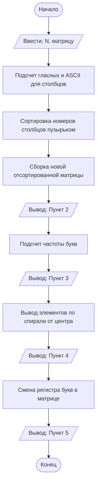

## Отчет по лабораторной работе № 1

#### № группы: `ПМ-2602`

#### Выполнил: `Капустин Александр Владимирович`

#### Вариант: `7`

### Содержание:

- [Постановка задачи](#1-постановка-задачи)
- [Входные и выходные данные](#2-входные-и-выходные-данные)
- [Выбор структуры данных](#3-выбор-структуры-данных)
- [Алгоритм](#4-алгоритм)
- [Программа](#5-программа)
- [Анализ правильности решения](#6-анализ-правильности-решения)

### 1. Постановка задачи

> Напишите программу на Java, которая выполняет следующие действия с двумерным массивом символов (строчные и заглавные буквы латинского алфавита):
> 1. Считывает с консоли размер массива N, затем элементы массива размером N × N.
> 2. Сортирует столбцы массива в порядке возрастания количества гласных букв в каждом столбце. При этом внутри столбца символы остаются на своих местах. Если показатели равны, сортирует столбцы по сумме ASCII-кодов символов.
> 3. Находит и выводит символ, который чаще всего встречается в массиве (без учёта регистра). Если таких символов несколько, выводит все.
> 4. Выводит элементы массива в виде спирали, начиная с центрального элемента и двигаясь против часовой стрелки. Реализовать алгоритм без использования дополнительных массивов.
> 5. Шифрует массив, изменяя регистр букв на противоположный, выводит зашифрованный массив.

Данную задачу можно разделить на 5 подзадач:
1. **Ввод:** Считать размер матрицы и её элементы.
2. **Сортировка:** Для каждого столбца посчитать гласные и сумму ASCII. Отсортировать индексы столбцов по заданным критериям и собрать новую матрицу.
3. **Поиск частого символа:** Пройтись по матрице, посчитать частоту каждой буквы (независимо от регистра), найти максимум и вывести все буквы с этим максимумом.
4. **Спираль:** Начать с центра, двигаться вправо, вверх, влево, вниз, увеличивая длину шага каждые 2 направления.
5. **Шифрование:** Пройтись по матрице и заменить каждую букву на противоположную по регистру (a->A, B->b).

### 2. Входные и выходные данные

#### Данные на вход

| Переменная | Тип                | Описание |
|------------|--------------------|----------|
| N          | Целое число (int)  | Размерность матрицы (N × N) |
| a[i][j]    | Символ (char)      | Латинские буквы (a-z, A-Z) |

#### Данные на выход

|                   | Тип    | Описание                                             |
|-------------------|--------|------------------------------------------------------|
| Отсортированная матрица | Символы | Матрица с переставленными столбцами |
| Частые символы    | Символы | Буквы с максимальной частотой |
| Спираль           | Символы | Элементы массива в порядке спирали |
| Зашифрованная матрица | Символы | Матрица со сменой регистра |

### 3. Выбор структуры данных

|             | название переменной | Тип (в Java) |
|-------------|---------------------|--------------|
| Матрица     | `a`                 | `char[][]`   |
| Гласные     | `vowels`            | `int[]`      |
| Сумма ASCII | `sum`               | `int[]`      |
| Индексы     | `order`             | `int[]`      |
| Частоты     | `count`             | `int[]`      |

Для хранения самой матрицы используется двумерный массив символов `char[][]`. Для подсчета метрик столбцов используются одномерные массивы `int[]`. Для поиска частых символов используется массив на 26 элементов (по количеству букв в алфавите). Дополнительные массивы для спирали не используются согласно условию.

### 4. Алгоритм

#### Алгоритм выполнения программы:

1. **Ввод данных:** Считываем `N`, затем `N*N` символов.
2. **Сортировка:**
    - Считаем `vowels[j]` и `sum[j]` для каждого столбца `j`.
    - Инициализируем массив `order` числами от 0 до N-1.
    - Сортируем `order` пузырьком, сравнивая столбцы по (1) гласным, (2) сумме ASCII.
    - Переставляем столбцы в матрице согласно `order`.
3. **Частый символ:**
    - Заполняем массив `count[26]`, увеличивая счетчик для буквы (приводим заглавные к строчным через ASCII).
    - Находим `max` в `count`.
    - Выводим все буквы, у которых `count[k] == max`.
4. **Спираль:**
    - Определяем центральную клетку (для четного N — левую-верхнюю из четырех).
    - Печатаем центр. Затем в цикле `while` движемся вправо, вверх, влево, вниз. Длина шага (`stepLen`) увеличивается каждые 2 направления.
5. **Шифрование:**
    - Проходим по матрице. Если символ `a-z`, меняем на `A-Z` (вычитаем 32 из ASCII). Если `A-Z`, меняем на `a-z` (прибавляем 32).


#### Блок-схема


```
import java.util.Scanner;

public class Main {
    public static void main(String[] args) {
        Scanner in = new Scanner(System.in);

        int n = in.nextInt();

        char[][] a = new char[n][n];

        for (int i = 0; i < n; i++) {
            for (int j = 0; j < n; j++) {
                a[i][j] = in.next().charAt(0);
            }
        }

        // ---- ПУНКТ 1
        // ---- 1. Считаем гласные и сумму ASCII по каждому столбцу ----
        int[] vowels = new int[n];
        int[] sum = new int[n];

        for (int j = 0; j < n; j++) {
            for (int i = 0; i < n; i++) {
                char ch = a[i][j];
                if (ch == 'a' || ch == 'e' || ch == 'i' || ch == 'o' || ch == 'u'
                        || ch == 'A' || ch == 'E' || ch == 'I' || ch == 'O' || ch == 'U') {
                    vowels[j]++;
                }
                sum[j] += (int) ch;
            }
        }

        // ---- 2. Номера столбцов 0, 1, 2, ..., n-1 ----
        int[] order = new int[n];
        for (int j = 0; j < n; j++) {
            order[j] = j;
        }

        // ---- 3. Пузырьковая сортировка номеров ----
        for (int i = 0; i < n - 1; i++) {
            for (int k = 0; k < n - 1 - i; k++) {

                int x = order[k];
                int y = order[k + 1];

                boolean needSwap = false;

                if (vowels[x] > vowels[y]) {
                    needSwap = true;
                } else if (vowels[x] == vowels[y]) {
                    if (sum[x] > sum[y]) {
                        needSwap = true;
                    } else if (sum[x] == sum[y] && x > y) {
                        needSwap = true;
                    }
                }

                if (needSwap) {
                    order[k] = y;
                    order[k + 1] = x;
                }
            }
        }

        // ---- 4. Собираем новый массив ----
        char[][] sorted = new char[n][n];
        for (int i = 0; i < n; i++) {
            for (int j = 0; j < n; j++) {
                sorted[i][j] = a[i][order[j]];
            }
        }
        a = sorted;

        // ---- ПУНКТ 2: вывод отсортированной матрицы ----
        System.out.println("Пункт 2 (сортировка). ");
        for (int i = 0; i < n; i++) {
            for (int j = 0; j < n; j++) {
                System.out.print(a[i][j] + " ");
            }
            System.out.println();
        }

        // ---- ПУНКТ 3: самый частый символ без учёта регистра ----
        int[] count = new int[26];
        for (int i = 0; i < n; i++) {
            for (int j = 0; j < n; j++) {
                char ch = a[i][j];
                if (ch >= 'a' && ch <= 'z') {
                    count[ch - 'a']++;         // строчная: 'a' = 97 → 0, 'z' = 122 → 25
                } else if (ch >= 'A' && ch <= 'Z') {
                    count[ch - 'A']++;         // заглавная: 'A' = 65 → 0, 'Z' = 90 → 25
                }
            }
        }

        int max = 0;
        for (int k = 0; k < 26; k++) {
            if (count[k] > max) max = count[k];
        }

        System.out.println("Пункт 3 ( символ, который чаще всего встречается в массиве). ");
        for (int k = 0; k < 26; k++) {
            if (count[k] == max) {
                System.out.print((char) ('a' + k) + " ");
            }
        }
        System.out.println();

        // ---- ПУНКТ 4: спираль от центра против часовой ----
        System.out.println("Пункт 4 (элементы массива в виде спирали). ");

        int r, c;
        if (n % 2 == 1) {
            r = n / 2;
            c = n / 2;
        } else {
            r = n / 2;
            c = n / 2 - 1;
        }

        int total = n * n;
        int done = 0;

        System.out.print(a[r][c] + " ");
        done++;

        int stepLen = 1;

        while (done < total) {
            for (int s = 0; s < stepLen && done < total; s++) {
                c++; System.out.print(a[r][c] + " "); done++;
            }
            for (int s = 0; s < stepLen && done < total; s++) {
                r--; System.out.print(a[r][c] + " "); done++;
            }
            stepLen++;
            for (int s = 0; s < stepLen && done < total; s++) {
                c--; System.out.print(a[r][c] + " "); done++;
            }
            for (int s = 0; s < stepLen && done < total; s++) {
                r++; System.out.print(a[r][c] + " "); done++;
            }
            stepLen++;
        }
        System.out.println();

        // ---- ПУНКТ 5: шифрование (смена регистра) ----
        System.out.println("Пункт 5 (зашифрованный массив). ");
        for (int i = 0; i < n; i++) {
            for (int j = 0; j < n; j++) {
                char ch = a[i][j];

                if (ch >= 'a' && ch <= 'z') {
                    ch = (char) (ch - 32);          // строчная → заглавная
                } else if (ch >= 'A' && ch <= 'Z') {
                    ch = (char) (ch + 32);          // заглавная → строчная
                }

                a[i][j] = ch;
                System.out.print(a[i][j] + " ");
            }
            System.out.println();
        }
    }
}
```
### 6. Анализ правильности решения

Программа работает корректно на всем множестве решений.

Тест на нечетный размер (N=3), смешанный регистр:

- **Input**::
```
3
a A b
c a C
B d a
```
- **Output**:
```
Пункт 2 (сортировка). 
a b A 
c C a 
B d a
```
Пункт 3 (символ, который чаще всего встречается в массиве). 
a 
```
Пункт 4 (элементы массива в виде спирали). 
C a A b a c B d a
```
Пункт 5 (зашифрованный массив). 
A B a 
C c A 
b D A 
```
Тест на четный размер (N=4), все символы уникальны:

- **Input**:
```
4
a b c d
e f g h
i j k l
m n o p
```
- **Output**:
```
Пункт 2 (сортировка). 
b d c a 
f h g e 
j l k i 
n p o m 
```
Пункт 3 (символ, который чаще всего встречается в массиве). 
a b c d e f g h i j k l m n o p
``` 
Пункт 4 (элементы массива в виде спирали). 
l k g h f j n p o m i e a d c b 
```
Пункт 5 (зашифрованный массив). 
B D C A 
F H G E 
J L K I 
N P O M 
```
Тест на минимальный размер (N=1), крайний случай:

- **Input**:
```
1
z
```
- **Output**:
```
Пункт 2 (сортировка). 
z
```
Пункт 3 (символ, который чаще всего встречается в массиве). 
z 
```
Пункт 4 (элементы массива в виде спирали). 
z
```
Пункт 5 (зашифрованный массив). 
Z 
```

Тест на несколько частых символов (ничья):

- **Input**:
```
2
a b
b a
```
- **Output**:
```
Пункт 2 (сортировка). 
a b 
b a 
```
Пункт 3 (символ, который чаще всего встречается в массиве). 
a b
```
Пункт 4 (элементы массива в виде спирали). 
b a a b 
```
Пункт 5 (зашифрованный массив). 
A B 
B A 
Z
```
